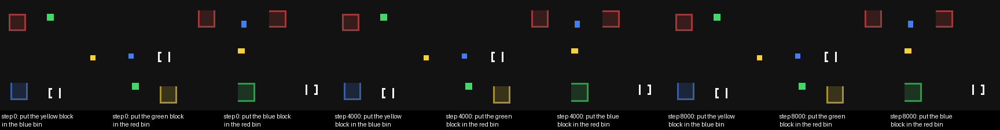

# microVLA

A pi0.5-style vision-language-action model trained from scratch on an RTX 3050 Laptop GPU (4 GB).



Same scene, two instructions: the policy follows the language, not a memorized trajectory.


## Results (RTX 3050 4 GB, 10.1M params)

| Metric | Value |
|---|---|
| Success, seen colour pairs (512 episodes) | **100.0%** |
| Success, held-out colour pairs never targeted in training | **91.8%** |
| Success, same scene with the instruction swapped to the other block | **97.1%** |
| Training time | 13 min SigLIP distillation + 31 min training (8,000 steps, batch 256) |
| Peak training VRAM | 1.9 GB |
| Action-chunk latency (10 actions, 10 flow steps, batch 1) | 64 ms |

## Run

```bash
python train.py --compile          # distill SigLIP -> ViT, then train; TensorBoard logs in runs/tb
python train.py --demo             # write assets/training.gif and assets/language_swap.gif
tensorboard --logdir runs          # http://localhost:6006
python train.py --compile --resume # continue after an interruption (checkpoint every 250 steps)
```

## Pretrained pi0.5: paired LIBERO evaluation

```bash
PYTHONPATH= /home/keyu/Documents/ChatGPT/Mujuco/.venv/bin/python eval_libero.py --suite libero_spatial --inits 10 --arms nf4+trim:10 nf4+trim:5 --videos 4
PYTHONPATH= /home/keyu/Documents/ChatGPT/Mujuco/.venv/bin/python eval_libero.py --suite libero_spatial --inits 10 --arms offload-3.5:10
PYTHONPATH= /home/keyu/Documents/ChatGPT/Mujuco/.venv/bin/python eval_libero.py --suite libero_spatial --summary
```

Add `--tasks 0 1` to select tasks. The runner sets `MUJOCO_GL=egl`, uses cached weights,
and defaults to `nf4+trim:10 nf4+trim:5`, loading the trimmed NF4 policy once.
Each task/init pair runs the arms in argument order. All resets select the same LIBERO init state and reset seed; each chunk
gets CPU-generated noise seeded by SHA-256 of suite, task, init and chunk index,
independent of the arm, pass, and earlier episodes. The second command adds the bf16,
untrimmed 10-step reference to the same JSONL. Use identical task/init selection and
protocol flags in both passes. Multiple placements in one `--arms` invocation run in
sequential worker processes; arms sharing a placement and trim configuration interleave
on each episode. NF4 and bf16 are never resident together. Before an offload worker
initializes the simulator or GPU, it estimates pinned RAM with the meta model and
uses `infer.check_pinned` with its 2 GiB reserve. Refusal exits with completed rows preserved.

Defaults follow the coordinator-verified openpi LIBERO protocol: execute the first
5 actions of each 50-action chunk, render both cameras at 256x256, seed every
environment reset with 7, and let LeRobot's reset perform 10 no-op settle steps
with `[0,0,0,0,0,0,-1]`. The policy-action limits exclude settling: spatial 220,
object 280, goal 300, libero_10 520, libero_90 400. Override these with `--replan`,
`--max-steps` (alias `--episode-length`), `--observation-height`,
`--observation-width`, `--seed`, and `--num-steps-wait`. Init indices are 0 through
`--inits - 1`; the default is 10. Set `--inits 50` for the official count per task;
finished episodes from a shorter run are reused.

LeRobot's `rollout()` prepares canonical images/state, applies the environment and
checkpoint preprocessors, calls `select_action()`, then applies the checkpoint and
environment postprocessors before stepping the simulator. The policy queue's
`n_action_steps` is temporarily set to `--replan` for each episode, keeping only
the first requested actions of each full prediction. Every row records the effective
`n_action_steps`, checkpoint `checkpoint_n_action_steps`, `chunk_size`, episode
limit, requested init count, `arm`, `placement`, `trim`, and a `protocol` object containing
the shared evaluation settings and checkpoint identity. `policy_calls` counts chunk predictions;
`mean_policy_latency_s` times synchronized chunk inference, excluding processors and
noise generation/transfer. `wall_time_s` includes reset and the rollout, excluding
model loading and video encoding.

Each finished episode is appended and fsynced to `runs/libero_eval_<suite>.jsonl`.
Restarting skips completed arm/task/init keys and repairs an unfinished final line.
Existing version-2 NF4+trim rows are recognized without rewriting completed lines.
Resume rejects changed protocol/checkpoint settings; archive the log
or run in another output directory when changing them. Increasing `--inits`, changing
task selection, or requesting videos does not change the protocol.
`--summary` summarizes all saved episodes without loading the policy or simulator:
success rates with Wilson 95% intervals per arm, a per-task table with one column per arm,
and a paired 2x2 table plus two-sided exact McNemar p-value for every pair of arms present.
Mean policy latency per arm is weighted by chunk call count. Incomplete pairs are counted separately and
excluded from the paired test. The summary is also written to
`runs/libero_eval_<suite>_summary.json`, including the saved protocol. Per-arm
rates include all finished episodes, including incomplete pairs. Published openpi
rates (Spatial 98.8%, Object 98.2%, Goal 98.0%, LIBERO-10 92.4%) appear as an external
sanity anchor from a different checkpoint/framework, never as a paired comparison.

Set `--videos` on the initial run (default 0). The first requested pairs get captioned
`*_paired.mp4` clips under `assets/libero/`, with arms in argument order within each placement
at the simulator's 20 Hz; the shorter episode holds its final frame. Scene clips are
cached for resumed pairing. Results are saved before encoding: a crash during encoding
can leave a completed episode without a scene clip, which is reported without rerunning
that episode. Exact init selection uses this installed LeRobot's private local
`_envs[0].init_state_id`; its public reset API has no init-state selector.

## Architecture (pi0.5, scaled down)

- **Vision**: SigLIP-style ViT, 64x64 image, 8x8 patches -> 64 tokens.
- **Prefix**: image tokens + instruction tokens + robot state discretized into 256-bin tokens (pi0.5 feeds state as text tokens, not a continuous input).
- **Backbone + action expert**: Gemma-style blocks (RMSNorm, GeGLU, RoPE, multi-query attention). Two sets of weights, one joint attention per layer. The prefix attends bidirectionally to itself; action tokens attend to the prefix and each other; the prefix never sees the actions.
- **Flow matching** with adaRMSNorm timestep conditioning in the action expert (pi0.5's change over pi0), Beta(1.5, 1) time sampling, 10 Euler steps at inference with the prefix KV cache computed once.

## What made it work

A ViT trained from scratch on this data could not localize the small objects: after 2,000 steps the predicted move direction had cosine 0.10 with the expert's and task success was 0%. Replacing the image with ground-truth object positions trained fine (cosine 0.86), which isolated the problem to vision.

Real pi0.5 starts from a pretrained SigLIP, so the fix bootstraps the same way. A frozen SigLIP-B/16 sees each render upsampled to 128 px, which gives the same 8x8 patch grid as the student. The student ViT is trained for 3,000 steps to match its patch features. With that initialization, the direction cosine reached 0.90 and success 86% after only 1,000 training steps.

Training data comes from a scripted expert with DART noise injection: the executed action is perturbed but the label is the clean expert chunk, so the policy learns to recover from its own mistakes.
