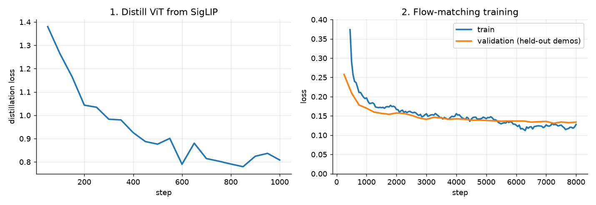
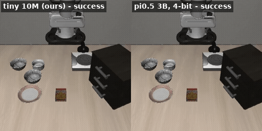
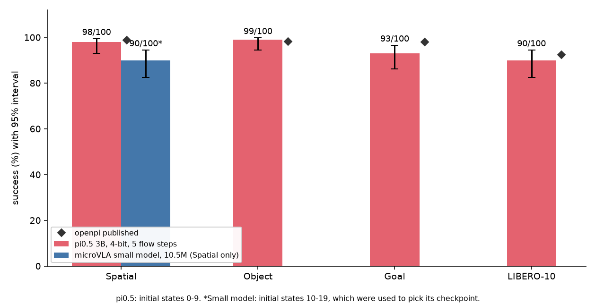

# microVLA

This repo aims to minimally implement VLA training and inference on my laptop GPU (RTX 3050, 4 GB), with small,
readable, mostly single-file implementations:

- a ~10M-parameter pi0.5-style model trained from scratch on LIBERO-Spatial demos, and
- the real pi0.5 (3B) running on the same 4 GB GPU.



Training the small model with the original recipe: the ViT is first distilled from SigLIP, then the whole model
trains with flow matching for 8k steps, about 25 minutes on the laptop.

Same LIBERO-Spatial episode, the 10M model trained here (left) and pi0.5 in 4-bit (right):



## How to run

Python 3.12, Linux, a CUDA GPU. Install with [uv](https://docs.astral.sh/uv/); versions are pinned in
`pyproject.toml` / `uv.lock`. A fresh install has not been tested on another machine yet.

```bash
git clone https://github.com/KhushiJ2911/microVLA.git && cd microVLA
uv sync
```

LIBERO renders with MuJoCo over EGL. On my laptop I render on the integrated GPU (Mesa) so the NVIDIA GPU keeps
all its VRAM for the model. The vendor file and device index depend on your machine:

```bash
export __EGL_VENDOR_LIBRARY_FILENAMES=/usr/share/glvnd/egl_vendor.d/50_mesa.json
export MUJOCO_EGL_DEVICE_ID=1
export CUDA_VISIBLE_DEVICES=0,1
```

Train the small model on LIBERO-Spatial and evaluate it:

```bash
uv run python -c "from libero.libero import benchmark"      # one-time LIBERO config (answer N)
uv run hf download lerobot/libero-assets --repo-type dataset --local-dir ~/.cache/libero/assets
uv run hf download google/siglip-base-patch16-224             # distillation teacher
uv run python train_libero.py --preprocess --stream --cache runs/libero_cache   # 96 px, one parquet at a time
uv run python train_libero.py --compile --cache runs/libero_cache               # distill, then flow matching
uv run python eval_libero.py --suite libero_spatial --inits 10 --tag mine --arms tiny:10
```

Run pretrained pi0.5 (needs access to the gated [PaliGemma](https://huggingface.co/google/paligemma-3b-pt-224)
tokenizer):

```bash
uv run hf auth login
uv run hf download lerobot/pi05_libero_finetuned_v044 --revision 7152f13e34c6c115d808aea0e5d08aca74eac14b
uv run hf download google/paligemma-3b-pt-224 --include 'tokenizer*' 'special_tokens_map.json'
uv run hf download HuggingFaceVLA/libero --repo-type dataset --include meta/tasks.parquet data/chunk-000/file-000.parquet
uv run python infer.py --config nf4+trim --steps 5            # latency / VRAM on cached frames
uv run python eval_libero.py --suite libero_spatial --inits 10 --tag mine --arms nf4+trim:5
```

Useful flags:

| Flag | What it does |
|---|---|
| `--resume` | continue training from the last checkpoint (written every 250 steps) |
| `--logger tensorboard\|wandb\|none` | TensorBoard is the default (`uv run tensorboard --logdir runs`); `wandb` also takes `--wandb-project`, `--wandb-run-name` |
| `--steps`, `--batch-size`, `--distill-steps`, `--ema 0.999`, `--save-every N` | training length and recipe |
| `--image-size 128` | with `--preprocess --stream`, builds a 128 px cache (`runs/libero_cache_128`); train on it with `--cache runs/libero_cache_128` |
| `--arms` | what to evaluate, e.g. `tiny:10` (10 flow steps), `nf4+trim:5`, `offload-3.5:10` |
| `--inits`, `--init-start` | which LIBERO initial states (0-49) to run |
| `--suite` | `libero_spatial`, `libero_object`, `libero_goal`, `libero_10` |

[sim.py](sim.py) and `train.py` also contain a toy 2D pick-and-place task (`uv run python train.py --compile`) that I
used to debug the model before moving to LIBERO.

## Details

Both models follow the pi0.5 design: a prefix of image patches, instruction tokens and discretized robot state goes
through a transformer, and a smaller action expert, attending to that prefix in the same layers, predicts a chunk of
future actions with flow matching:

$$
\mathcal{L}(\theta)=\mathbb{E}_{a,\epsilon,t}\left\|v_\theta\big((1-t)\,a+t\,\epsilon,\ t \mid \text{images, instruction, state}\big)-(\epsilon-a)\right\|^2
$$

At inference the model starts from noise and takes 10 (or 5) Euler steps along $v_\theta$ to get the actions.

The small model ([train.py](train.py), LIBERO data and training in [train_libero.py](train_libero.py)):

| Part | Size |
|---|---|
| Vision | ViT, 4 layers, width 192, 8 px patches; 2 cameras (scene + wrist) at 96 px share it, plus a camera embedding |
| Prefix transformer | 6 layers, width 256, GeGLU MLP 1024 |
| Action expert | 6 layers, width 128, adaRMSNorm conditioned on the flow time $t$ |
| Attention | shared across prefix and expert in every layer, 4 query heads, 1 KV head, RoPE |
| State | 8 values, each discretized into 256 bins and fed as tokens |
| Output | chunk of 16 actions (7-D), first 5 executed, then replan |
| Parameters | 10.5M (vision 1.9M, prefix 5.7M, action expert 2.3M) |

A ViT this small, trained from scratch on ~430 demos, does not learn to localize small objects well. So training
starts with a short distillation: the ViT's patch features are matched (cosine + MSE through a linear head) to frozen
SigLIP-B/16 features of the same image upsampled 2x, which gives the same patch grid. Then the whole model trains with
the flow-matching loss on 52,970 frames from the 432 LIBERO-Spatial demos (HuggingFaceVLA/libero), with random-shift
augmentation.

## Inference optimisations

pi0.5 in bf16 does not fit in 4 GB. What [infer.py](infer.py) does:

| Technique | Effect (RTX 3050 4 GB, median per 50-action chunk on cached frames) |
|---|---|
| Build the model on the meta device, load weights one tensor at a time, drop unused vocabulary heads | low host-RAM peak while loading |
| NF4 4-bit weights (bitsandbytes) for the vision and language linear layers; action expert stays bf16 | fits: 1,147 ms, 3.22 GiB peak VRAM |
| `+trim`: drop the masked, empty third camera, pad the prompt to 64 tokens instead of 200 | 1,147 -> 813 ms (1.4x), 3.13 GiB |
| 5 flow steps instead of 10 | 813 -> 662 ms (1.7x vs NF4), success unchanged (98/100 vs 98/100) |
| Alternative: keep bf16 and stream part of the prefix from pinned CPU RAM (`offload-3.5`) | full precision, 1,682 ms, 3.12 GiB |
| Render the simulator on the integrated GPU | keeps MuJoCo off the NVIDIA GPU during evaluation |

Raw numbers: [runs/inference_bench.json](runs/inference_bench.json), plot: [assets/inference_bench.png](assets/inference_bench.png).

## Results

Closed-loop LIBERO, following the openpi evaluation settings (replan every 5 actions, per-suite step limits, 256 px
renders, seed 7). 10 tasks x 10 initial states = 100 episodes per row.

| Suite | pi0.5, NF4 + trim, 5 steps | pi0.5 published by openpi | microVLA small model (10.5M) |
|---|---:|---:|---:|
| Spatial | 98/100 | 98.8% | 90/100* |
| Object | 99/100 | 98.2% | - |
| Goal | 93/100 | 98.0% | - |
| LIBERO-10 | 90/100 | 92.4% | - |



pi0.5 runs on initial states 0-9. *The small model is trained only on the 10 Spatial tasks, so it is only evaluated
there. Its 90/100 is on initial states 10-19, which were also used to pick the checkpoint (longer recipe: 3k
distillation steps, batch 64, EMA, colour jitter); a held-out test on states 20-49 is running. The small model takes
about 65 ms per action chunk.

Does compression cost success? Same 100 Spatial episodes:

| pi0.5 setting | Success | Mean model time per chunk in rollouts |
|---|---:|---:|
| bf16, CPU offload, 10 steps | 99/100 | 3,273 ms |
| NF4 + trim, 10 steps | 98/100 | 815 ms |
| NF4 + trim, 5 steps | 98/100 | 700 ms |

All three are statistically the same (paired McNemar p = 1). Per-episode logs are in [runs/](runs/).

## Citation

```bibtex
@misc{microvla2026,
  author = {KhushiJ2911},
  title  = {microVLA: minimal VLA training and inference on a 4 GB laptop GPU},
  year   = {2026},
  url    = {https://github.com/KhushiJ2911/microVLA}
}
```

Built on:
[pi0](https://arxiv.org/abs/2410.24164) ·
[pi0.5](https://arxiv.org/abs/2504.16054) ·
[openpi](https://github.com/Physical-Intelligence/openpi) ·
[LeRobot](https://github.com/huggingface/lerobot) ·
[LIBERO](https://arxiv.org/abs/2306.03310) ·
[SigLIP](https://arxiv.org/abs/2303.15343) ·
[flow matching](https://arxiv.org/abs/2210.02747)

Code: [MIT](LICENSE). Models, datasets and simulator assets keep their own licenses; no weights are redistributed.
