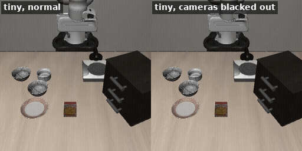
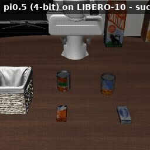

# microVLA

A small, readable pi0.5-style VLA, meant to be trained from scratch on a 4 GB laptop GPU.
The model starts from random weights and learns vision from a frozen SigLIP teacher.
This repo also runs pretrained pi0.5 on the same GPU.

Same LIBERO-Spatial episode, the 10M model trained here (left) and pi0.5 in 4-bit (right):


The tiny model with its cameras blacked out does not find the bowl (0/100), so it is using vision, not replaying a memorised motion:



pi0.5 (4-bit) on a two-object LIBERO-10 task, 2x speed:




Images, instructions and state go through a shared transformer with a separate action expert. [train.py](train.py) has the model and flow-matching loop. [sim.py](sim.py) is a toy 2D pick-and-place task that trains in under an hour; it is useful for debugging the model before moving to LIBERO.

$$
\mathcal{L}(\theta)=\mathbb{E}_{a,\epsilon,t}\left[\left\|v_\theta((1-t)a+t\epsilon,t\mid\text{images, instruction, state})-(\epsilon-a)\right\|^2\right]
$$

The model learns the velocity between an action chunk $a$ and Gaussian noise $\epsilon$; inference integrates from noise back to actions.

## Run it

Python 3.12, Linux and a CUDA GPU. Versions in [pyproject.toml](pyproject.toml) match the local environment; a fresh install has not been tested.

```bash
git clone https://github.com/KhushiJ2911/microVLA.git && cd microVLA && uv sync
uv run python train.py --compile
uv run python train.py --demo
```

Before LIBERO evaluation, set up MuJoCo EGL rendering. On the measured laptop, Mesa EGL on the integrated GPU kept rendering out of NVIDIA VRAM:

```bash
export __EGL_VENDOR_LIBRARY_FILENAMES=/usr/share/glvnd/egl_vendor.d/50_mesa.json
export MUJOCO_EGL_DEVICE_ID=1
export CUDA_VISIBLE_DEVICES=0,1
```

The vendor path and device indices depend on your machine. The evaluator sets `MUJOCO_GL=egl`. Loading pi0.5 and CPU offload also need host RAM.

Initialize LIBERO's paths (answer N for defaults), download simulator assets and the SigLIP teacher, then preprocess and train.

```bash
uv run python -c "from libero.libero import benchmark"
uv run hf download lerobot/libero-assets --repo-type dataset --local-dir ~/.cache/libero/assets
uv run hf download google/siglip-base-patch16-224
uv run python train_libero.py --preprocess --stream --cache runs/libero_cache
uv run python train_libero.py --cache runs/libero_cache
uv run python eval_libero.py --suite libero_spatial --inits 10 --tag reproduce --arms tiny:10
```

Add `--resume` to continue training. Logs go to TensorBoard by default (`uv run tensorboard --logdir runs`); pass `--logger wandb` (optionally `--wandb-project`, `--wandb-run-name`) to use Weights & Biases instead, or `--logger none`. A resumed run continues the same W&B run.

## Pretrained pi0.5 on 4 GB

[infer.py](infer.py) builds the model on the meta device, removes unused vocabulary heads and loads weights one tensor at a time. NF4 stores the vision/language linear weights in 4 bits; the action expert stays bf16. `+trim` drops the masked, empty third camera and pads the prompt to 64 tokens instead of 200, rejecting longer prompts. Using 5 flow steps instead of 10 reduces denoising time. The bf16 CPU-offload option trades latency for GPU memory.

Accept the gated [PaliGemma terms](https://huggingface.co/google/paligemma-3b-pt-224) and log in for the pi0.5 tokenizer. Download first: `infer.py` runs offline.

```bash
uv run hf auth login
uv run hf download lerobot/pi05_libero_finetuned_v044 --revision 7152f13e34c6c115d808aea0e5d08aca74eac14b
uv run hf download google/paligemma-3b-pt-224 --include 'tokenizer*' 'special_tokens_map.json'
# Cached frames for the inference demo:
uv run hf download HuggingFaceVLA/libero --repo-type dataset --include meta/tasks.parquet data/chunk-000/file-000.parquet
uv run python infer.py --config nf4+trim --steps 5
uv run python infer.py --config offload-3.5 --steps 10
uv run python eval_libero.py --suite libero_spatial --inits 10 --tag reproduce --arms nf4+trim:5
```

Measured on an RTX 3050 Laptop GPU with 4 GB VRAM:

| Configuration | Flow steps | Cached-frame median | Peak allocated VRAM | Spatial rollout mean |
|---|---:|---:|---:|---:|
| NF4 | 10 | 1,147 ms | 3.22 GiB | — |
| NF4 + trim | 10 | 813 ms | 3.13 GiB | 815 ms |
| NF4 + trim | 5 | 662 ms | 3.13 GiB | 700 ms |
| bf16 CPU offload (`offload-3.5`) | 10 | 1,682 ms | 3.12 GiB | 3,273 ms |

Cached-frame timing includes processing and action transfer; rollout timing measures only the model, excluding processing and simulation. pi0.5 predicts 50 actions and executes 5 before replanning. These are chunk latencies, not control rates. Cached-frame values come from [runs/inference_bench.json](runs/inference_bench.json), plotted in [this figure](assets/inference_bench.png); rollout values come from the [Spatial summary](runs/libero_eval_libero_spatial_summary.json).

## LIBERO results

Successes out of 100 episodes per suite: the same 10 tasks with init states 0–9. pi0.5 uses NF4 + trim with 5 flow steps; tiny uses 10.

| Suite | pi0.5 | Tiny |
|---|---:|---:|
| Spatial | 98/100 | 75/100 |
| Object | 99/100 | 0/100 |
| Goal | 93/100 | 0/100 |
| LIBERO-10 | 90/100 | 0/100 |

[Episode logs and summaries](runs/) include Wilson intervals and paired comparisons. Tiny trains on the same 10 Spatial tasks, with different initial states: this is in-distribution imitation. Its zero-shot success on each other suite is 0%. On Spatial, removing both images or just the wrist image gives 0/100; wrong instructions give 1/100; removing state gives 4/100.

A revised training recipe's selected snapshot scored 90/100 versus the original model's 71/100 on [dev init states 10–19](runs/libero_eval_libero_spatial_dev_summary.json). Dev results were used for checkpoint selection. Final held-out testing is pending; the table and figure above use the original tiny model.

Use a new `--tag` for fresh evaluations. Repeat with `--suite libero_object`, `libero_goal` or `libero_10` for the other suites. [eval_libero.py](eval_libero.py) resumes completed episodes; `uv run python plot_libero.py --all` redraws the figure from the bundled, untagged logs.

[pi0 paper](https://arxiv.org/abs/2410.24164) · [pi0.5 paper](https://arxiv.org/abs/2504.16054) · [openpi](https://github.com/Physical-Intelligence/openpi) · [LeRobot](https://github.com/huggingface/lerobot) · [LIBERO](https://github.com/Lifelong-Robot-Learning/LIBERO)

Original code: [MIT](LICENSE). Models, datasets and simulator assets have their own upstream terms. No weights are redistributed.
