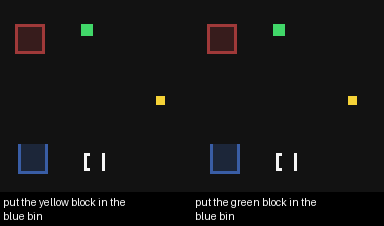

# microVLA

A pi0.5-style vision-language-action model trained from scratch on an RTX 3050 Laptop GPU (4 GB).


Same scene, two instructions: the policy follows the language, not a memorized trajectory.



## Results (RTX 3050 4 GB, 10.1M params)

| Metric | Value |
|---|---|
| Success, seen colour pairs (512 episodes) | **100.0%** |
| Success, held-out colour pairs never targeted in training | **91.8%** |
| Success, same scene with the instruction swapped to the other block | **97.1%** |
| Training time | 13 min SigLIP distillation + 31 min training (8,000 steps, batch 256) |
| Peak training VRAM | 1.9 GB |
| Action-chunk latency (10 actions, 10 flow steps, batch 1) | 64 ms |

## Run

```bash
python train.py --compile          # distill SigLIP -> ViT, then train; TensorBoard logs in runs/tb
python train.py --demo             # write assets/training.gif and assets/language_swap.gif
tensorboard --logdir runs          # http://localhost:6006
python train.py --compile --resume # continue after an interruption (checkpoint every 250 steps)
```

## Architecture (pi0.5, scaled down)

- **Vision**: SigLIP-style ViT, 64x64 image, 8x8 patches -> 64 tokens.
- **Prefix**: image tokens + instruction tokens + robot state discretized into 256-bin tokens (pi0.5 feeds state as text tokens, not a continuous input).
- **Backbone + action expert**: Gemma-style blocks (RMSNorm, GeGLU, RoPE, multi-query attention). Two sets of weights, one joint attention per layer. The prefix attends bidirectionally to itself; action tokens attend to the prefix and each other; the prefix never sees the actions.
- **Flow matching** with adaRMSNorm timestep conditioning in the action expert (pi0.5's change over pi0), Beta(1.5, 1) time sampling, 10 Euler steps at inference with the prefix KV cache computed once.

## What made it work

A ViT trained from scratch on this data could not localize the small objects: after 2,000 steps the predicted move direction had cosine 0.10 with the expert's and task success was 0%. Replacing the image with ground-truth object positions trained fine (cosine 0.86), which isolated the problem to vision.

Real pi0.5 starts from a pretrained SigLIP, so the fix bootstraps the same way. A frozen SigLIP-B/16 sees each render upsampled to 128 px, which gives the same 8x8 patch grid as the student. The student ViT is trained for 3,000 steps to match its patch features. With that initialization, the direction cosine reached 0.90 and success 86% after only 1,000 training steps.

Training data comes from a scripted expert with DART noise injection: the executed action is perturbed but the label is the clean expert chunk, so the policy learns to recover from its own mistakes.
